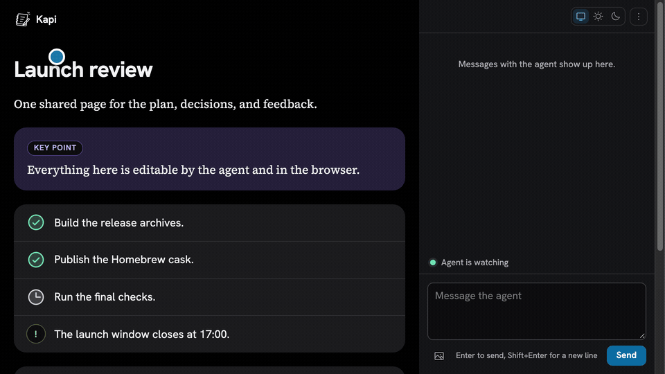
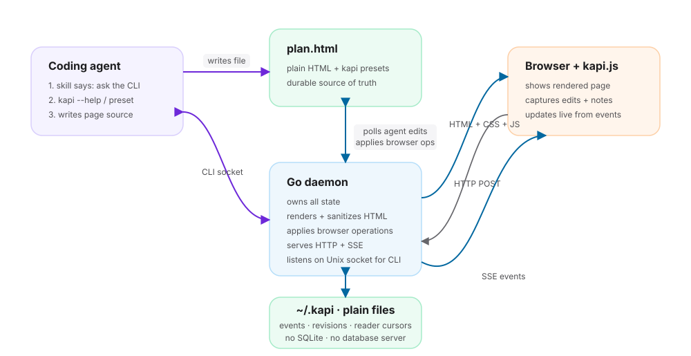

<h1>
  <picture>
    <source media="(prefers-color-scheme: dark)" srcset="docs/logo-dark.svg">
    
  </picture>
  kapi <sub>कापी</sub>
</h1>

One shared HTML page that you and your coding agent both write to.



## How it works



One Go binary serves the browser UI and keeps page history as local files—no Node or database.

## Install

kapi ships via [xaaha/tap](https://github.com/xaaha/homebrew-tap). Homebrew 6.0+ requires explicit trust for third-party taps; without it, `brew upgrade` silently skips kapi. One-time step per machine:

```sh
brew trust xaaha/tap
brew install --cask xaaha/tap/kapi
kapi setup
```

`kapi setup` asks which installed agents to connect, then installs or repairs
kapi's embedded skill and startup hooks. It does not use Node or `npx`.

Other install options:

- `go install github.com/xaaha/kapi/cmd/kapi@latest`
- Build from source with `go build -o kapi ./cmd/kapi`

kapi runs on macOS and Linux.

### Shell completion (go install / source builds)

Homebrew installs completion automatically. If you installed via `go install`
or built from source, opt in once:

```sh
# zsh: add to ~/.zshrc, after compinit
source <(kapi completion zsh)

# bash: add to ~/.bashrc
eval "$(kapi completion bash)"
```

## Usage

```sh
kapi send --on cutover plan.html "is this still true?"   # as the human
kapi wait plan.html                                        # as the agent: print what is unseen and exit
kapi say --seen 4 plan.html "yes, confirmed at 14:20"      # reply as the agent, having read #4
kapi say --reply 5 plan.html "moved it to Track B"         # answer note #5, so its pin turns answered
kapi attach --after k3f9a2bq plan.html chart.png           # add an image block, stored in plan.files/
kapi export --md plan.html                                 # write plan.md, or plan.zip with its images
kapi seen plan.html 4                                      # or say you read #4 without replying
kapi status plan.html
kapi version
kapi --help
```

Use `kapi wait <page>` for one event at a time, or `kapi watch <page>` to stream.

The page menu exports HTML, Markdown or PDF, copies the path, and ends the
session. Ending stops watchers but keeps the page and history; the next message
resumes it.

## Agent harnesses

Run `kapi setup` after installation. Detected agents are preselected; press
Enter to accept them or enter a comma-separated list:

```sh
kapi setup                              # ask, then install/repair
kapi setup --agents claude,codex,pi    # non-interactive selection
kapi setup --project --agents claude,pi # project-local skills
kapi setup --remove                     # remove only kapi-managed files/hooks
```

Global skills are written to the standard harness paths, including
`~/.claude/skills/kapi/SKILL.md`, `~/.agents/skills/kapi/SKILL.md` for Codex
and Pi, `~/.config/opencode/skills/kapi/SKILL.md`, and
`~/.copilot/skills/kapi/SKILL.md`. Re-running repairs them.

The skill contains stable rules and sends agents to `kapi`, `kapi --help` and
`kapi preset` for current commands and page structure, so an installed copy
does not become a stale CLI manual. Startup hooks provide ambient page and
unread-message discovery where a harness supports them. Restart agent sessions
after setup.

